<p align="center">
  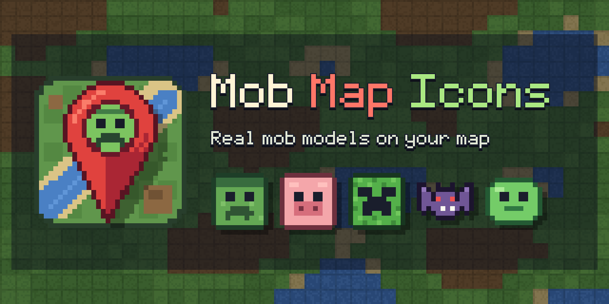
</p>

# Mob Map Icons

A client-side NeoForge 1.21.1 mod that replaces the little mob heads and coloured dots on your map mod
with icons rendered from each mob's **real in-game model and texture**. The icons are drawn from the
model at runtime, so modded mobs get proper icons too, with no per-mob art needed.

Works with **FTB Chunks**, **Xaero's Minimap**, **Xaero's World Map** and **JourneyMap**. Every one of
them is optional: install any subset, and the adapters for the missing ones stay dormant.

<p align="center">
  
</p>

## Features

- **Real models.** Full body or head, rendered from the mob's own model and texture. Babies, sheep
  colours, cat and wolf variants, villager professions and slime sizes each get their own icon.
- **Icons turn with the mob.** Eight facing directions, picked from the mob's heading.
- **Ten icon styles, switchable live.** Outline (default), badge, retro and more, from the in-game
  config screen or `/mobmapicons style <name>`. Every style is generated from the game's own render,
  so it works for modded mobs.
- **Farm mode.** Crowds of the same mob merge into one icon with a count (`x144`), so a mob farm is
  readable instead of a blob.
- **Players too.** Other players are drawn from their own skin, full body, turning with their heading
  (FTB Chunks and JourneyMap). You always keep the map mod's own marker.
- **Live config.** Every setting applies without a restart, and a **quick options panel** floats over the map
  so you see the change as you make it (see below).

<p align="center">
  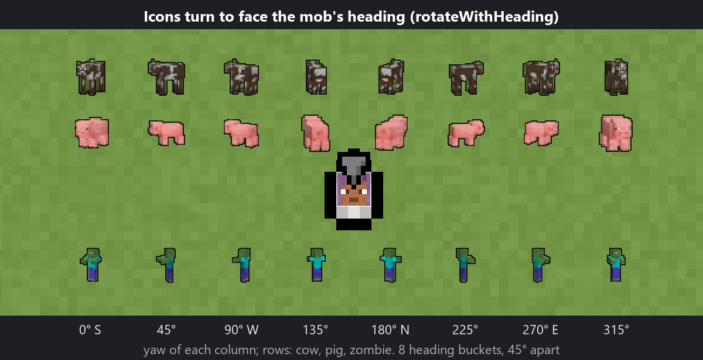
</p>

## Styles

Set `iconStyle` in the config, or run `/mobmapicons style <name>`. Same view, all ten styles:

<p align="center">
  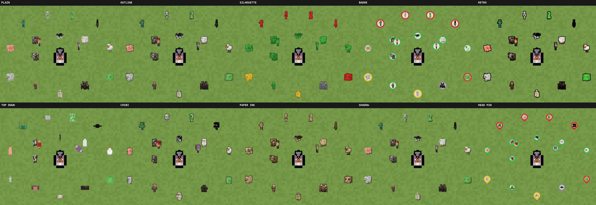
</p>

Badge, silhouette and head pin tint by category: hostile red, neutral yellow, water blue, ambient grey,
otherwise green (from the game's own `Enemy`, `NeutralMob` and `MobCategory`, so modded mobs follow it).

## Quick options over the map

Bind **Quick options panel** (Controls > Mob Map Icons) or run `/mobmapicons options`. A small panel opens on top of the
minimap or any fullscreen map (FTB Chunks, Xaero's World Map, JourneyMap) and every change shows on the map behind it at once.
One compact view, no scrolling: style, mode, size, rotate, arrow, farm, players and your own icon. Style, mode and the
tri-state rows step on a **click** and on the **mouse wheel** over the row; **right click** or **shift+click** steps back.
The size row edits the view you are on: over a fullscreen map it is the full-screen size, in the world it is the minimap
size, and the small **Mini / Full** button at its right switches to the other one. Drag the header to move the panel, Esc
closes it. Changing style and size for one map mod is three clicks: its tab, Style, Size.

A map mod's tab has a **Same as global** toggle: on, the tab follows the Global tab; turn it off (or just change a value)
and the tab keeps its own copy to edit. Rarely used rows (the map mod's own options, max icons, cluster radius) sit on a
second page behind **More >**.

The panel knows which map you are on. Opened over FTB Chunks' large map, JourneyMap's fullscreen map or Xaero's World Map
it shows **that map mod's** section; over the minimap (no screen) it opens on the first installed map mod. A tab bar
(Global, plus one tab per installed map mod) switches section. On the **More >** page of a map mod's tab are a few of that
mod's **own** icon options (FTB Chunks: large icons, entity heads, player heads; JourneyMap: mob heading, show self, mob
scale, self scale), written through that mod's own setters. The JourneyMap tab also has **JM mobs** and **JM players** rows
(JourneyMap's Mob Display and Player Display) and the **JM auto icons** toggle, see below. Xaero's own options are left to
its screen. A row that the installed map mod version does not support is simply not shown.

<p align="center">
  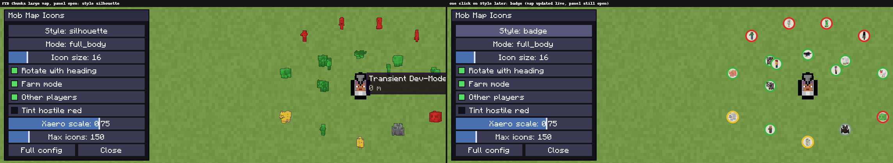
</p>
<p align="center">
  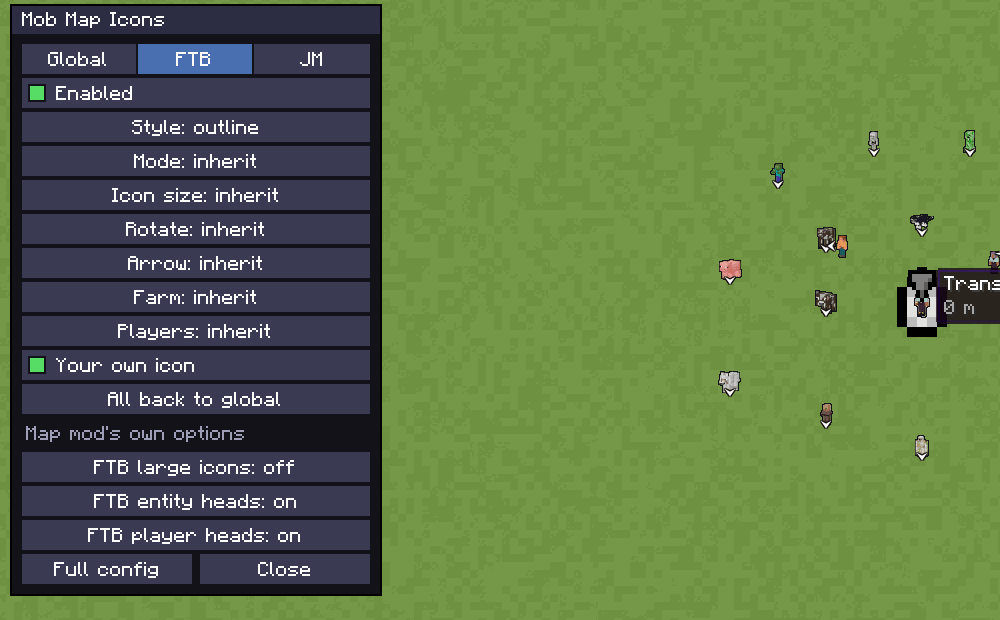
  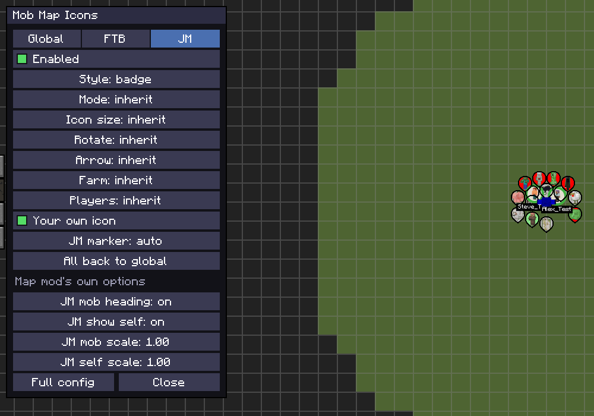
</p>
<p align="center">
  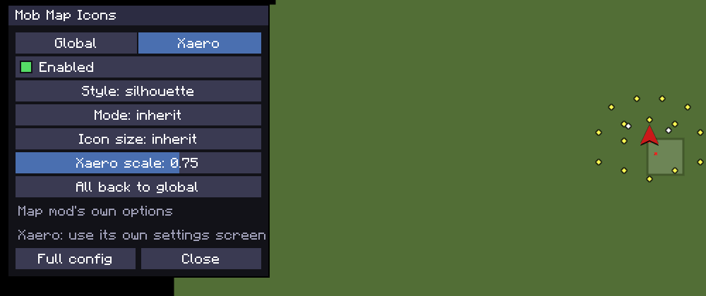
</p>

## One look per map mod

Every installed map mod has its own section in the config (`[ftb]`, `[xaero]`, `[journeymap]`). Each can override the
style, mode, size, heading rotation, heading arrow, farm mode and other-players option; anything left on `INHERIT`
(size `0`) follows the global value. So FTB Chunks can show `OUTLINE` icons while JourneyMap shows `BADGE`, at the same time.
Sections of map mods that are not installed do not exist: no map mod, no section.

<p align="center">
  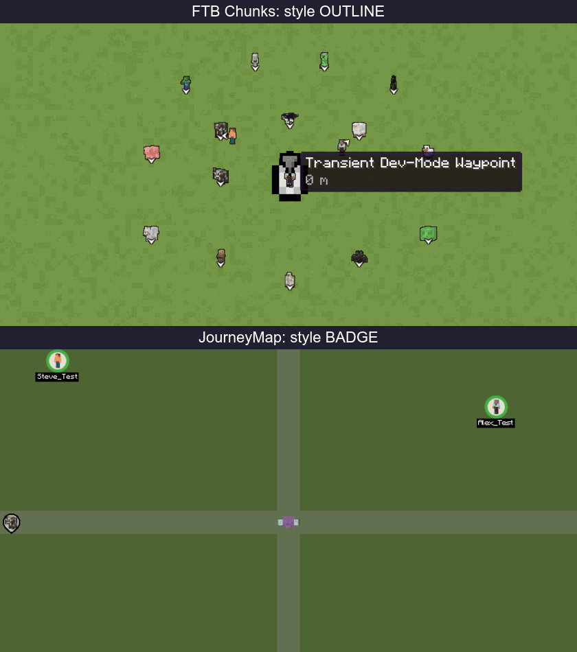
</p>

## Your own icon

`ownPlayer = true` in a map mod's section draws **you** with our icon and replaces that map mod's own marker. It is off by default;
the global `players` option still means other players only.

- **FTB Chunks:** large map: your player entry is swapped for our icon. Minimap: our icon replaces the face (FTB's pointer arrow stays).
- **JourneyMap:** minimap and fullscreen map: the marker's two textures are rewritten in place with a top-down render of you
  (it turns with the camera, so only the top-down view makes sense). While it is on, JourneyMap's "self" colour is set to white in
  memory so it does not tint the icon blue; your value is put back when you turn it off.
- **Xaero:** not supported. Xaero draws its arrow from code, and replacing that needs a Mixin; the option is not offered.

<p align="center">
  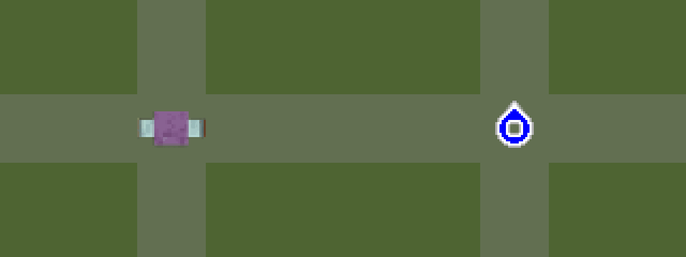
</p>

## Full body or head

`iconMode = HEAD` draws the head and shoulders, bigger in the frame, for every plain-body style. Flying and very wide mobs
(bats, dragons, ghasts) keep their full body.

<p align="center">
  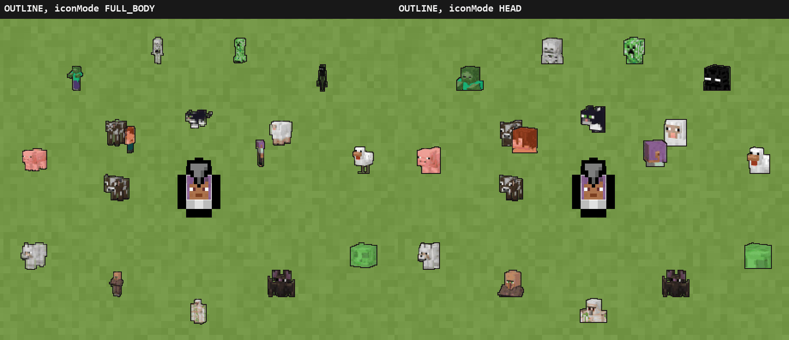
</p>

## Farm mode

<p align="center">
  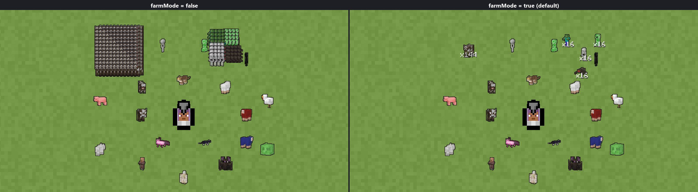
</p>

Same-kind mobs close together merge into one icon. Zoom in and they split again. Named, leashed, tamed
and boss mobs are never merged. `maxIcons` caps how many icons a map draws (nearest first).
JourneyMap has no count badge, so there the count is the label (`144 x Cow`) and the duplicates are hidden.

<p align="center">
  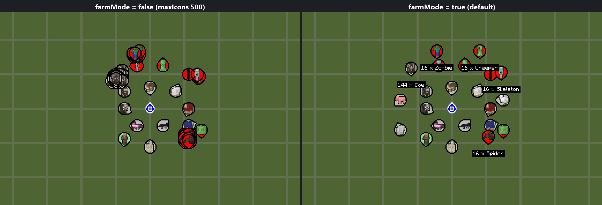
</p>

## Players

<p align="center">
  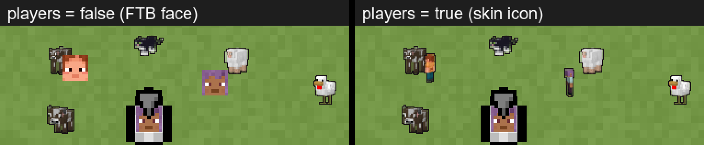
</p>
<p align="center">
  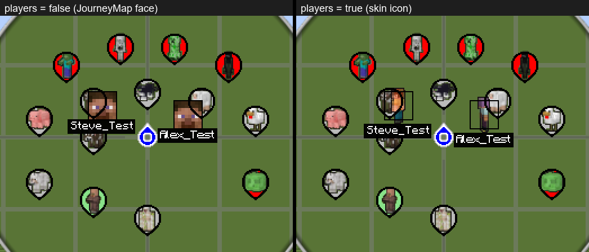
</p>

Turn it off with `players = false` to get the map mods' faces back. Xaero keeps its own player heads.

## Apotheosis bosses

<p align="center">
  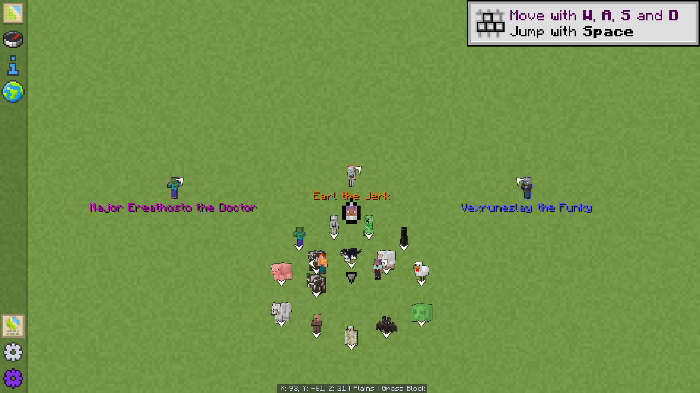
</p>
<p align="center">
  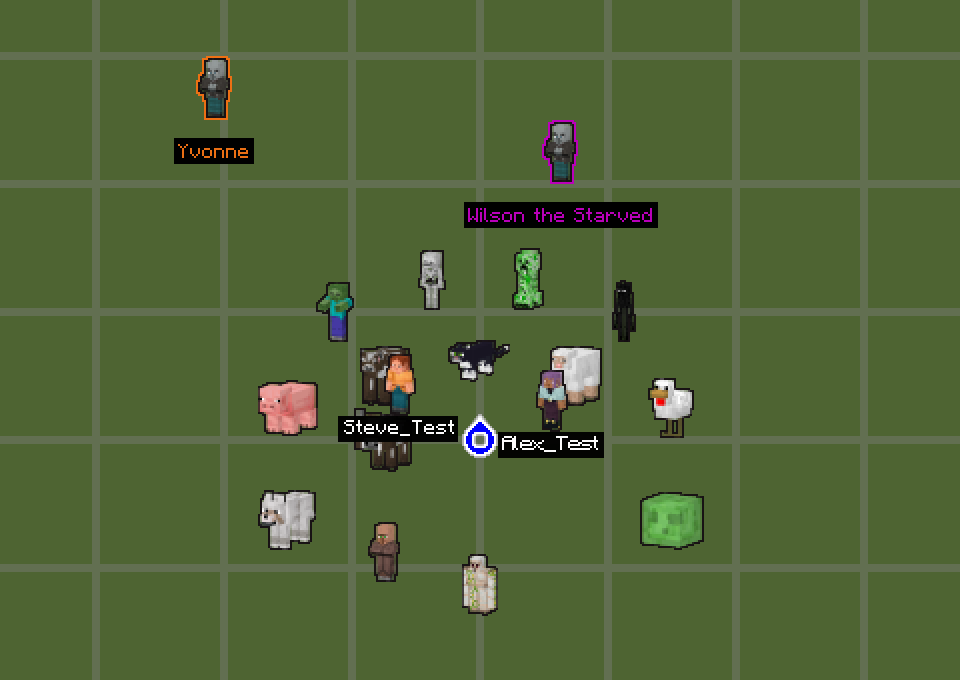
</p>

Apotheosis invader bosses get an outline in their rarity colour and their name under the icon (FTB Chunks, JourneyMap). Client side only, no Apotheosis dependency: a boss is recognised from its custom name plus a worn affix item named after it. Options `apotheosisBossOutline` and `apotheosisBossNames` (both on). Xaero draws one sprite per mob type, so it cannot mark single mobs.

## Screenshots

| FTB Chunks minimap | FTB Chunks large map |
|---|---|
| 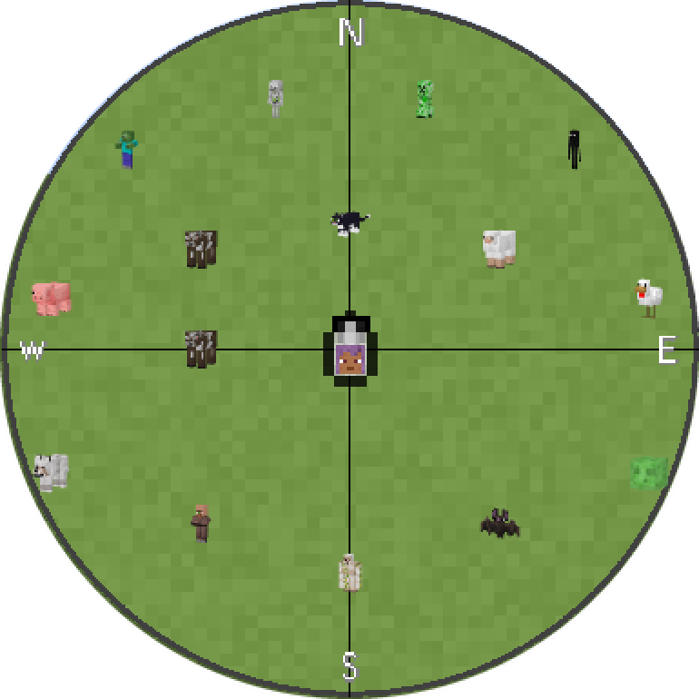 | 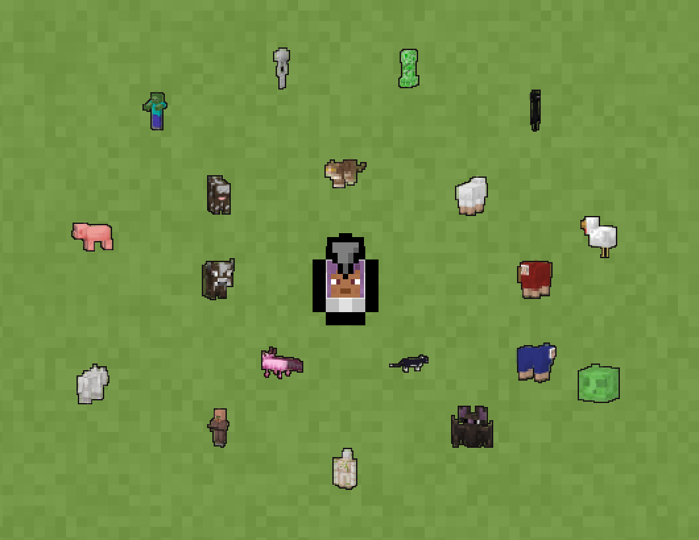 |

| Xaero's Minimap | Xaero's World Map |
|---|---|
| 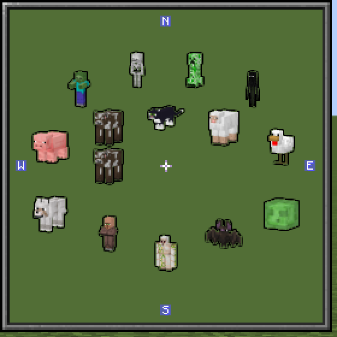 | 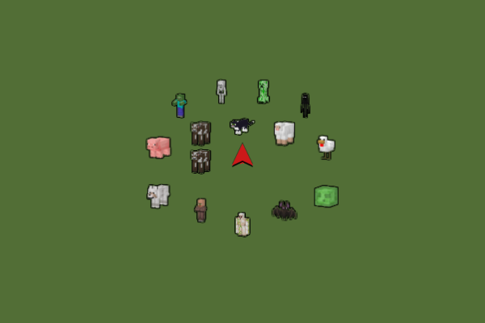 |

| JourneyMap minimap | JourneyMap fullscreen |
|---|---|
| 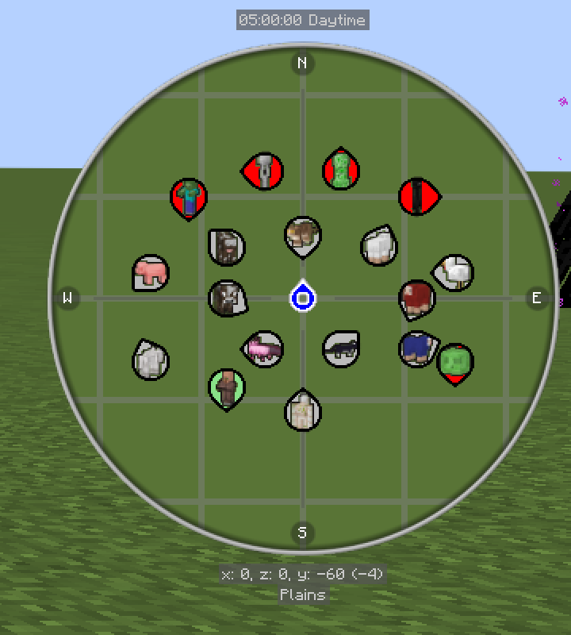 |  |

The test setup and versions are in [`docs/screenshots/README.txt`](docs/screenshots/README.txt).

## Install

1. Minecraft 1.21.1 with NeoForge 21.1+.
2. Drop `mob_map_icons-<version>+neoforge-1.21.1.jar` in `mods/` (client only; do not put it on a server).
3. Have at least one supported map mod installed.

| Map mod | Tested version | Notes |
|---|---|---|
| FTB Chunks | 2101.1.24 | Heading, variants, farm mode. For bigger minimap icons set `minimap.large_entities=true`. |
| Xaero's Minimap / World Map | 26.6.0 / 1.47.0 | Set the radar's "Display icons" to **Always** (Xaero's default is "Player List"). |
| JourneyMap | 6.0.9 | Heading, variants, farm mode. JourneyMap draws mob icons at its own fixed size. |

Other versions may work. An unsupported map mod version just leaves its adapter off; it never stops the
game from loading.

## Config

Open **Mods > Mob Map Icons > Config** in game, or edit `config/mob_map_icons-client.toml`.

<p align="center">
  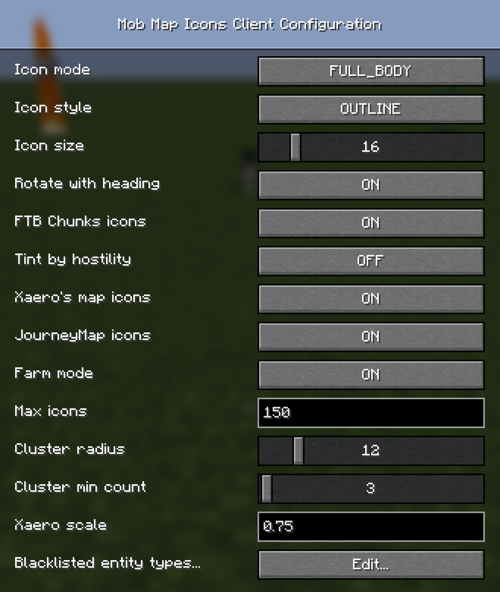
</p>

| Option | Default | What |
|---|---|---|
| `iconStyle` | `OUTLINE` | PLAIN, OUTLINE, SILHOUETTE, BADGE, RETRO, TOP_DOWN, CHIBI, PAPER_INK, SHADOW, HEAD_PIN |
| `iconMode` | `FULL_BODY` | `FULL_BODY` or `HEAD` (head and shoulders). CHIBI, HEAD_PIN and TOP_DOWN choose their own view |
| `iconSizeMinimap` | `16` | Icon edge length on minimaps in pixels (8 to 64). Replaces the single `iconSize` of 0.4.3 and older; an old value seeds both size keys |
| `iconSizeFullscreen` | `16` | Icon edge length on full-screen maps (FTB Chunks' large map, JourneyMap's full-screen map). Xaero draws one sprite for its minimap and World Map, so it follows `iconSizeMinimap` |
| `rotateWithHeading` | `false` | Turn each icon to face the way the mob is heading (8 directions). Off: every icon faces you |
| `headingArrow` | `true` | Small arrow on each icon pointing the way the mob faces (FTB Chunks, JourneyMap). Works with or without `rotateWithHeading` |
| `[ftb]`, `[xaero]`, `[journeymap]` | only for installed map mods | Per-map-mod overrides, see below |
| `farmMode` | `true` | Merge crowds of the same mob into one icon (FTB Chunks: count badge; JourneyMap: label) |
| `clusterRadius`, `clusterMinCount` | `12`, `3` | Merge distance in screen pixels, and the smallest group that merges |
| `players` | `true` | Draw other players as their skin's model (FTB Chunks, JourneyMap) |
| `maxIcons` | `150` | Most mob icons per map, nearest first (0 = no limit) |
| `tintByHostility` | `false` | Tint hostile mobs' icons red (FTB Chunks) |
| `blacklist` | `[]` | Entity type ids that get no icon, e.g. `"minecraft:armor_stand"` |

### Per-map-mod sections

`[ftb]`, `[xaero]` and `[journeymap]` exist only when that map mod is installed. Every key overrides the global one for that
map mod only; the default is "inherit".

| Option | Default | What |
|---|---|---|
| `enabled` | `true` | Use Mob Map Icons in this map mod (replaces the old flat `ftbChunks`, `xaero`, `journeymap` switches) |
| `iconStyle` | `INHERIT` | `INHERIT` or any style |
| `iconMode` | `INHERIT` | `INHERIT`, `FULL_BODY` or `HEAD` |
| `iconSizeMinimap` | `0` | `0` = the global `iconSizeMinimap`, else 8 to 64 |
| `iconSizeFullscreen` | `0` | `0` = the global `iconSizeFullscreen`, else 8 to 64 (in `[xaero]` it is the World Map's size) |
| `rotateWithHeading`, `headingArrow`, `farmMode`, `players` | `INHERIT` | `INHERIT`, `ON` or `OFF` (not in `[xaero]`: it has one static icon per mob type and keeps its player heads) |
| `ownPlayer` | `false` | Draw your own marker with our icon (FTB Chunks, JourneyMap) |
| `xaeroScale` | `0.75` | `[xaero]` only: how much of Xaero's icon box the icon fills (0.25 to 1.0). The icon is drawn at `xaeroScale` x size / 16 of the box, so a size of 16 is the old look and 24 is half as big again (at most 60 of the box's 64 px) |
| `autoIconDisplay` | `true` | `[journeymap]` only: JourneyMap draws its own dot or pin round our icons unless its **Mob Display** and **Player Display** are `Icons`. On: while this adapter is enabled both are set to `Icons` for the minimap and the full-screen map, and your previous values come back when the adapter is disabled, this is turned off, or the game quits (JourneyMap's own files never keep `Icons` while this mod is gone; the next start sets them again) |
| `journeymapFrame` | `AUTO` | `[journeymap]` only: `AUTO` hides its pin when the style draws its own frame, `ON` always keeps it, `OFF` always hides it |

Old config files keep working: the first time they load, the old flat `ftbChunks`, `xaero`, `journeymap`, `xaeroScale` and
`journeymapFrame` values, and the `iconSize` keys (global and per map mod), are read and become the defaults of the new
keys. The icon cache is keyed by size, so a minimap and a full-screen map with different sizes each get a sharp icon.

JourneyMap's own Mob Display and Player Display values are remembered in
`config/mob_map_icons-journeymap-saved-display.properties` while `autoIconDisplay` holds them at `Icons`. If you change
them yourself in JourneyMap (or from the panel's JM rows) they are left alone: choosing a non-`Icons` value in the panel
turns `autoIconDisplay` off. The panel's JM tab has a **JM rows edit: minimap / full-screen map** button, so the JM rows
(mobs, players, heading, show self, scales) can edit either view from either place.

Xaero's World Map has its own icon size (`[xaero] iconSizeFullscreen`, else the global one) next to the minimap's. Xaero reads
both from one set of sprites, so the mod keeps two sets and swaps in the World Map's while Xaero's World Map screen is open
(one icon reload when it opens or closes, nothing per frame, and nothing at all while both sizes are equal).

Client commands: `/mobmapicons options` (quick panel), `/mobmapicons style <name>`, `/mobmapicons reload` (rebuild icons),
`/mobmapicons render <entity_type>`, `/mobmapicons headings` (all 8 headings of the mob you look at) and
`/mobmapicons dump` (every cached icon plus contact sheets, written to `mob_map_icons_dump/` in the game folder).

## How it works

- **Core:** the first time a mob (variant, heading, style) is seen, it is drawn once offscreen from its
  real model (at most 2 per frame, so there is no hitch), styled, and cached as a texture and PNG bytes
  (LRU, 512 icons). The cache clears on a resource reload and when an icon setting changes; the old icon
  stays on screen until the new one is ready.
- **FTB Chunks:** the adapter swaps FTB's own entity icons in the map-icon event for ours. FTB's
  filtering, tooltips and hotkeys still apply, and a mob whose icon is not ready yet keeps FTB's head.
- **Xaero:** a top-priority in-memory resource pack serves Xaero's per-entity icon definitions and
  sprites, so no Mixin is needed. World Map shares the Minimap's radar renderer.
- **JourneyMap:** a JourneyMap API v2 plugin sets each mob's icon on the radar update event, served from
  an in-memory pack, padded so wide mobs fit JourneyMap's round marker.

## Known limitations

- **Xaero:** icons are per mob type (no baby, colour or heading variants), because Xaero's icon
  definitions are static per type. Every sheep is white there. Icons are larger than Xaero's own heads;
  lower `xaeroScale` (0.5 is about Xaero's size). With different sizes the icons are reloaded once (a blink) when the World Map
  opens or closes. Xaero's sprites are a fixed 64 x 64 box, so no icon gets bigger than 60 px.
- **Players:** a full-body skin icon is narrow, so it reads smaller than JourneyMap's or FTB's face. JourneyMap
  players are swapped through its private face cache (tested on 6.0.9; if it changes, JourneyMap keeps its faces)
  and keep JourneyMap's square outline box. Xaero is not supported.
- **JourneyMap:** there is no count badge, and farm-mode labels can overlap on a crowded minimap.
- Head mode finds the model's head part. Flying and wide mobs (bats, phantoms, ghasts, the dragon) get the
  full body instead, and a head facing away shows the back of the body.
- Armour and held items are not drawn. Slime sizes get separate icons that look the same.
- **Own icon:** off by default; not available for Xaero (its marker is drawn from code). On JourneyMap the icon is a fixed top-down view and JourneyMap's self colour is whitened in memory while it is on.
- **Heading arrow:** Xaero draws one fixed icon per mob type, so it never shows the arrow. JourneyMap draws its own heading arrow when its "show mob heading" setting is on, and then ours is left out.
- With `rotateWithHeading` on, long-tailed mobs (cats) look smaller, because every heading shares one frame.
- Variant detection covers the vanilla renderer layers. A mod that draws its own variants in a custom
  render event may be missed.

## Building

```bat
build.bat build
```

Output: `build/libs/mob_map_icons-<version>+neoforge-1.21.1.jar`. `build.bat` uses a portable JDK in
`toolchain\` or an Eclipse Adoptium JDK 21. Dev runs: `runClient`, `runSelftest` (renders sample mobs
and dumps PNGs), `runScene` (a map test world; see `build.gradle`).

Layout: `api/` (`MobIconApi`, the only read API), `core/` (renderer, cache, styles, virtual resource
pack), `compat/<mapmod>/` (one adapter each, loaded by class name only when that mod is present). Each
adapter owns its `compileOnly` dependency in a marked `// === compat:<name> ===` block in `build.gradle`.
API notes for each map mod are in [`docs/research`](docs/research).

## Credits and licence

MIT, see [LICENSE](LICENSE). Not affiliated with FTB, Xaero or JourneyMap; their mods are optional
runtime integrations and nothing from them is bundled.
