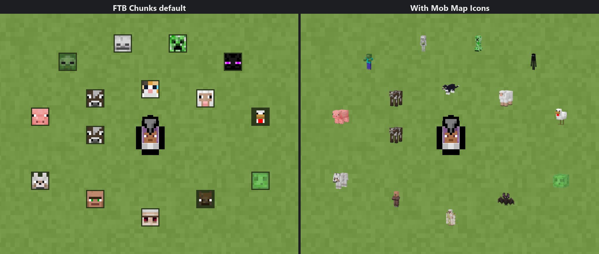
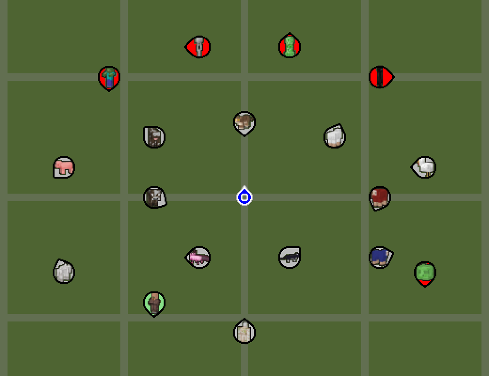

<p align="center">
  
</p>

# Mob Map Icons

A client-side NeoForge 1.21.1 mod that replaces the little mob heads and coloured dots on your map mod
with icons rendered from each mob's **real in-game model and texture**. Because the icons are rendered
from the model at runtime, modded mobs get proper icons too, with no per-mob art needed.

Works with **FTB Chunks**, **Xaero's Minimap**, **Xaero's World Map** and **JourneyMap**. Every one of
them is optional: install any subset, and the adapters for the missing ones stay dormant.

<p align="center">
  
</p>

## Screenshots

| FTB Chunks minimap | Xaero's World Map |
|---|---|
|  |  |

| JourneyMap fullscreen | Xaero's Minimap |
|---|---|
|  |  |

More in [`docs/screenshots`](docs/screenshots) (FTB large map, JourneyMap minimap), with the test setup
in its `README.txt`.

## Install

1. Minecraft 1.21.1 with NeoForge 21.1+.
2. Drop `mob_map_icons-<version>+neoforge-1.21.1.jar` in `mods/` (client only; do not put it on a server).
3. Have at least one supported map mod installed.

| Map mod | Tested version | Notes |
|---|---|---|
| FTB Chunks | 2101.1.24 | Minimap: set `minimap.large_entities=true` for bigger icons. |
| Xaero's Minimap / World Map | 26.6.0 / 1.47.0 | Set the radar's "Display icons" to **Always** (Xaero's default is "Player List"). |
| JourneyMap | 6.0.9 | JourneyMap draws mob icons at its own fixed size. |

Other versions may work. An unsupported map mod version just leaves its adapter off; it never stops the
game from loading.

## Config

`config/mob_map_icons-client.toml`

| Option | Default | What |
|---|---|---|
| `iconMode` | `FULL_BODY` | `FULL_BODY` or `HEAD` |
| `iconSize` | `16` | Icon edge length in pixels (8 to 64) |
| `rotateWithHeading` | `true` | Turn each icon to face the way the mob is heading (8 directions) |
| `ftbChunks`, `xaero`, `journeymap` | `true` | Turn an adapter on or off |
| `tintByHostility` | `false` | Tint hostile mobs' icons red (FTB Chunks) |
| `blacklist` | `[]` | Entity type ids that get no icon, e.g. `"minecraft:armor_stand"` |

Commands (client): `/mobmapicons render <entity_type>` and `/mobmapicons dump` write the rendered icons
as PNGs to `mob_map_icons_dump/` in the game folder (`dump` also writes `contact_sheet.png`).
`/mobmapicons headings` writes all 8 headings of the mob you look at (or the nearest one) as one sheet.

## How it works

- **Core:** the first time a mob type is seen, it is drawn once offscreen from its real model (a few
  types per frame, so there is no hitch) and cached as a texture and as PNG bytes. The cache clears on a
  resource reload and when the icon mode or size changes.
- **FTB Chunks:** the adapter swaps FTB's own entity icons in the map-icon event for ours. FTB's
  filtering, tooltips and hotkeys still apply, and a mob whose icon is not ready yet keeps FTB's head.
- **Xaero:** a top-priority in-memory resource pack serves Xaero's per-entity icon definitions and
  sprites, so no Mixin is needed. World Map shares the Minimap's radar renderer.
- **JourneyMap:** a JourneyMap API v2 plugin sets each mob's icon on the radar update event, served from
  the same in-memory pack.

## Known limitations

- The core renders one icon per variant (baby, colour, profession, size) and per heading, but the map
  adapters still ask for the per-type icon, so maps show one icon per mob type until they switch.
- Head mode finds the model's head part. Flying and wide mobs (bats, phantoms, ghasts, the dragon) get
  the full body instead, and a head facing away shows the back of the body.
- Armour and held items are not drawn. Slime sizes get separate icons that look the same.
- With `rotateWithHeading` on, long-tailed mobs (cats) look smaller, because every heading shares one frame.
- JourneyMap: `iconSize` has no visible effect, and wide mobs can spill past the round marker.
- Xaero: icons are larger than Xaero's heads at low zoom.

## Building

```bat
build.bat build
```

Output: `build/libs/mob_map_icons-<version>+neoforge-1.21.1.jar`. `build.bat` uses a portable JDK in
`toolchain\` or an Eclipse Adoptium JDK 21. Dev runs: `runClient`, `runSelftest` (renders sample mobs
and dumps PNGs), `runScene` (a map test world; see `build.gradle`).

Layout: `api/` (`MobIconApi`, the only read API), `core/` (renderer, cache, virtual resource pack),
`compat/<mapmod>/` (one adapter each, loaded by class name only when that mod is present). Each adapter
owns its `compileOnly` dependency in a marked `// === compat:<name> ===` block in `build.gradle`.
API notes for each map mod are in [`docs/research`](docs/research).

## Credits and licence

MIT, see [LICENSE](LICENSE). Not affiliated with FTB, Xaero or JourneyMap; their mods are optional
runtime integrations and nothing from them is bundled.
